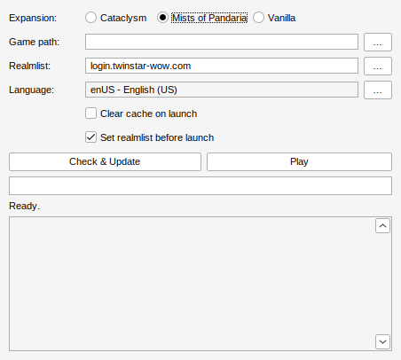

# twinlauncher - the unofficial [TwinStar Launcher](https://twinstar-wow.com/launcher/latest.zip) alternative

[](LICENSE)

A lightweight Windows launcher for the [TwinStar](https://twinstar-wow.com) World of Warcraft private server, written in Go. Designed to replace the original .NET/WPF launcher with no .NET dependency.

Runs cleanly under Wine on Linux and macOS which was the main motivation for this launcher.

## What it does

- Selects the WoW expansion: **Cataclysm**, **Mists of Pandaria**, or **Vanilla**
- Refuses to update a folder that holds another expansion's client (version check like the original)
- Downloads and updates game files from the TwinStar CDN (resumable, with progress, picks up partial downloads of the original launcher)
- Lets you choose the game language for Mists of Pandaria (same list as TwinStar Launcher 1.0.3)
- Patches `Config.wtf` and `realmlist.wtf` with the correct realmlist before launching
- Launches the WoW client (`Wow-64.exe`, `Wow.exe`, or `WoW.exe`)
- Saves your settings (expansion, paths, realmlist) between sessions

Settings are stored in `twinlauncher_settings.json` next to the exe.

## Screenshot


## License

MIT — see [LICENSE](LICENSE).

## Credits

Code written by [Claude](https://claude.ai) (Anthropic), directed and tested by [idaho@mst.cz](mailto:idaho@mst.cz).

## Requirements to run

- A working Wine bottle (or Windows machine) with a TwinStar WoW installation
- `appsettings.json` from the original TwinStar Launcher — must be in the **same folder** as `twinlauncher.exe`

## Requirements to build

- Go 1.24 or later (`build.sh` downloads it if missing)
- Nothing else: the build is pure Go (no CGO, no mingw)

## Building

```bash
CGO_ENABLED=0 GOOS=windows GOARCH=amd64 \
  go build -trimpath -ldflags="-s -w -H windowsgui" -o twinlauncher.exe .
```

Or just run the included script:

```bash
bash build.sh
```

The Windows application manifest (common controls v6, DPI awareness) lives in `twinlauncher.manifest` and is embedded via `rsrc_windows_amd64.syso`. After editing the manifest, regenerate it:

```bash
go run github.com/akavel/rsrc@v0.10.2 -manifest twinlauncher.manifest -arch amd64 -o rsrc_windows_amd64.syso
```

## Tests

The package only builds for Windows, so run the tests under Wine:

```bash
GOOS=windows go test -exec wine .
```

## Setup

1. Copy `twinlauncher.exe` into your Wine bottle **next to** `appsettings.json` (the same folder as the original `TwinStar Launcher.exe`)
2. Run `twinlauncher.exe` via Wine or Bottles
3. Select your expansion (and for MoP the game language) and set the game path (Windows-style path, e.g. `C:\Games\WoW_Cata`)
4. Click **Check && Update** to download/verify game files
5. Click **Play** to launch WoW
